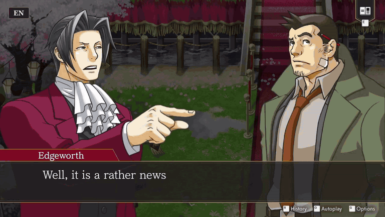
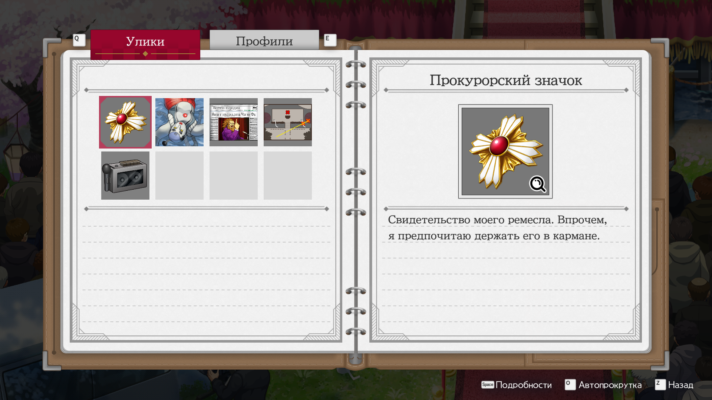
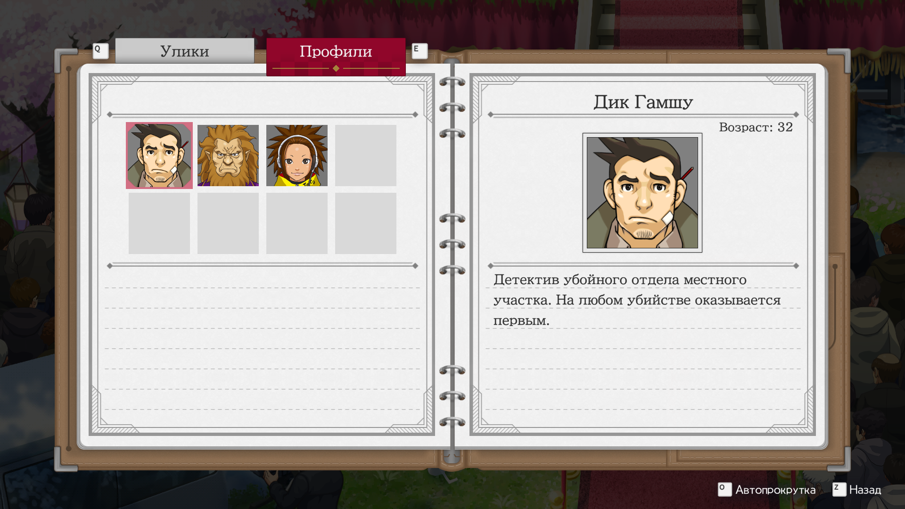
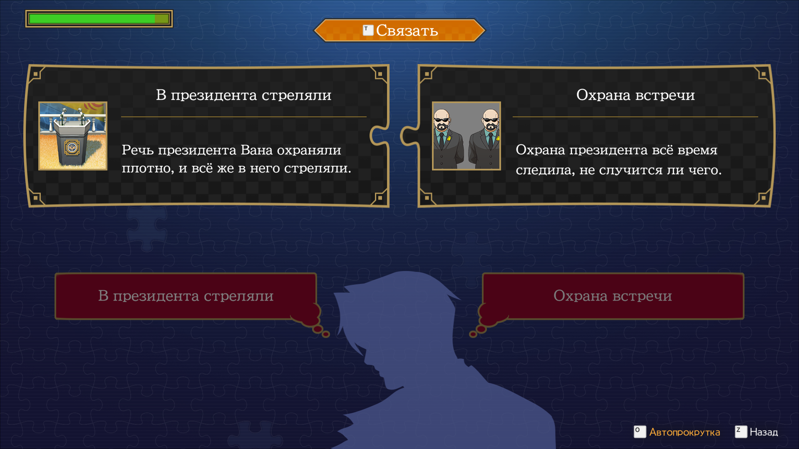
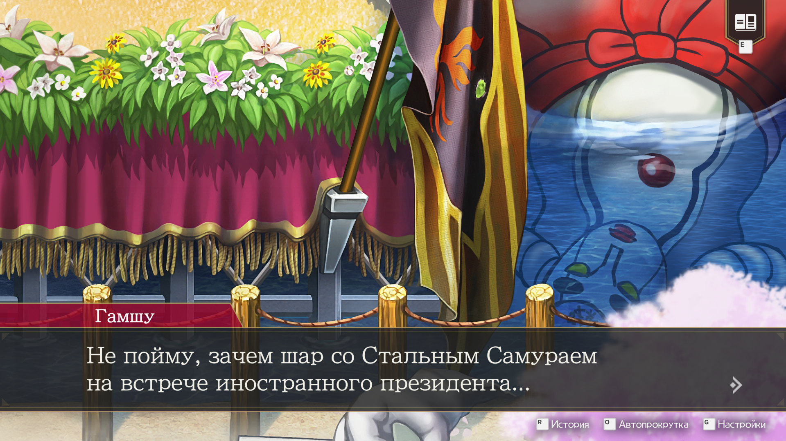
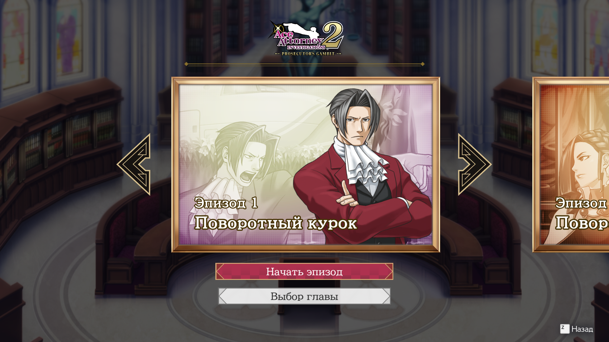
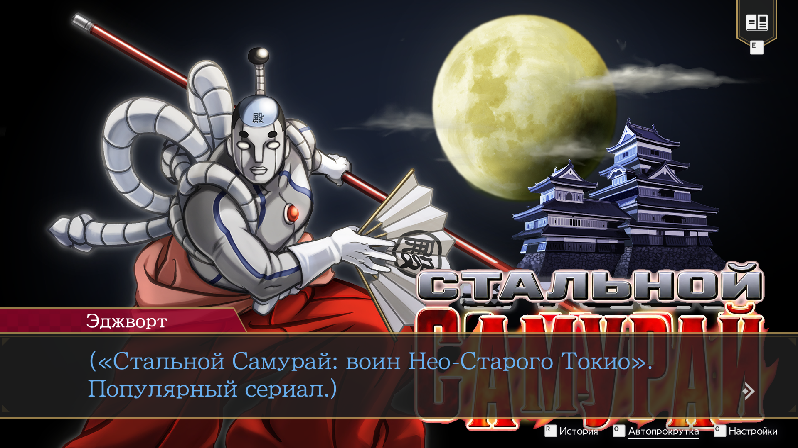
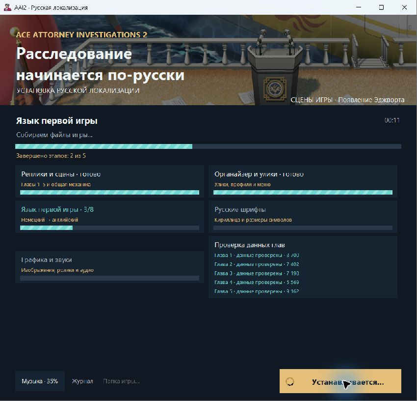
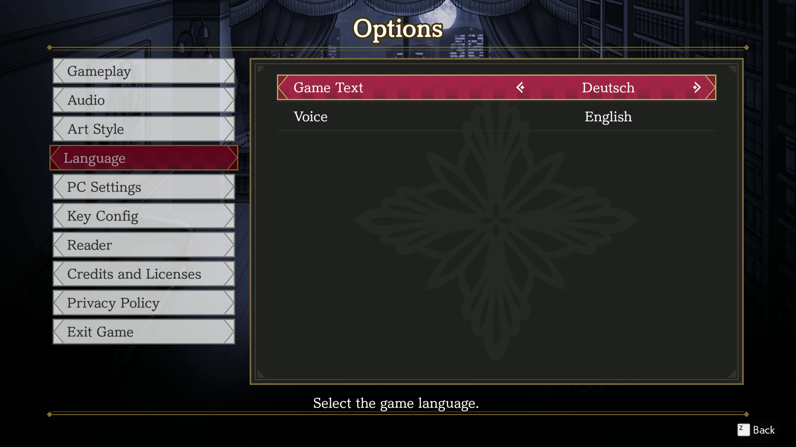

<div align="center">

# Ace Attorney Investigations 2 по-русски

**Фанатский перевод «Prosecutor's Gambit» из сборника Ace Attorney Investigations Collection.<br>
Все пять дел — от первой реплики до последней.**

[](https://github.com/CanICallYouJim/ace_attorney_investigations_translate_to_RU/releases/latest)
[](https://github.com/CanICallYouJim/ace_attorney_investigations_translate_to_RU/releases)
[](https://store.steampowered.com/app/2401970/)
[](LICENSE)



[](https://github.com/CanICallYouJim/ace_attorney_investigations_translate_to_RU/releases/latest/download/AAI2-RU.exe)

<sub>[AAI2-RU.exe](https://github.com/CanICallYouJim/ace_attorney_investigations_translate_to_RU/releases/latest/download/AAI2-RU.exe) · 91 МБ · сборка от 2026-11-16 · [что нового в выпуске](https://github.com/CanICallYouJim/ace_attorney_investigations_translate_to_RU/releases/latest)</sub>

**После установки обязательно выберите Deutsch в настройках языка игры.**

[Ролик и скриншоты](#как-это-выглядит) · [Установка](#установка) · [Частые вопросы](#частые-вопросы) · [Нашли ошибку?](#нашли-ошибку)

</div>

## Что внутри

- **Весь сюжет второй части.** Пять дел и общая механика: реплик переведено
  33 422 из 33 422.
- **Всё, что вокруг реплик.** Меню, сохранения, названия глав, улики, профили
  персонажей, «Логика» и ментальные шахматы: строк интерфейса — 2 517.
- **Надписи на картинках.** Газеты, вывески, планы, записки, выкрики: картинок
  переведено 242 из 242. Часть названий
  и логотипов нарочно оставлена как в оригинале.

- **Установщик с окном, музыкой и полосой на каждый этап.** Сам находит игру,
  сохраняет оригиналы и снимает перевод одной командой.

Отдельно от PNG сцены и интерфейса учитываются надписи на 3D-моделях: **2 из 2 текстур материалов**.

**Дела:** «Поворотный курок» · «Поворот за решёткой» · «Поворотное наследие» ·
«Забытый поворот» · «Поворот на века».

## Как это выглядит

https://github.com/user-attachments/assets/2cdee098-48fe-4f0e-b1d2-55a753a22fd6

<table>
<tr><td align="center" width="50%"><br><sub>Улика в органайзере</sub></td><td align="center" width="50%"><br><sub>Профиль персонажа</sub></td></tr>
<tr><td align="center" width="50%"><br><sub>«Логика»</sub></td><td align="center" width="50%"><br><sub>Осмотр места</sub></td></tr>
<tr><td align="center" width="50%"><br><sub>Выбор эпизода</sub></td><td align="center" width="50%"><br><sub>Надписи на картинках</sub></td></tr>
</table>

## Установка

**Что нужно:** Windows и купленная
[Ace Attorney Investigations Collection](https://store.steampowered.com/app/2401970/)
в Steam.

1. **Закройте игру.** Пока она запущена, её файлы заняты.
2. **Запустите [`AAI2-RU.exe`](https://github.com/CanICallYouJim/ace_attorney_investigations_translate_to_RU/releases/latest/download/AAI2-RU.exe)
   и нажмите «Установить перевод».** Игру он найдёт сам — в библиотеках Steam
   или на любом локальном диске. Не нашёл — кнопка «Папка игры…» внизу окна:
   укажите папку, где лежит `GK12.exe`.

   

3. **Обязательный шаг: запустите игру и выберите Deutsch.** В английском меню
   откройте **Options → Language → Game Text** и выберите **Deutsch**. Подтвердите
   смену языка кнопкой **Yes**. Перевод занимает немецкий слот и включается
   после выбора этого пункта.

   

Установщик показывает пять этапов, у каждого своя полоса и счётчик: реплики
и сцены, органайзер и улики, язык первой игры, русские шрифты, графика и звуки.
Фон и музыка берутся из вашей же игры, музыку можно выключить кнопкой. Дольше
всего идут шрифты и графика: кириллицы в игре нет, буквы приходится в неё доучивать.

**Новая версия перевода** ставится поверх старой тем же способом. Уже сделанное
установщик не переделывает, поэтому повторный запуск намного быстрее первого.

> [!NOTE]
> Windows может предупредить о неизвестном издателе: у любительского патча нет
> цифровой подписи. «Подробнее» → «Выполнить в любом случае». Не хочется запускать
> чужой `.exe` — тот же перевод ставится скриптом, см. вопросы ниже.

## Частые вопросы

<details>
<summary><b>Что осталось по-английски?</b></summary>

- **Голосовые выкрики** вроде «Objection!» — это звук, а не надпись.
- **Названия музыкальных треков и имена в галерее персонажей.** Больше половины
  галереи — из первой игры.
- **Некоторые названия и логотипы на картинках** сохранены в оригинале.
- **Первая игра сборника.** Её в переводе нет, для неё есть
  [русификатор Unknown Translators Team](https://vk.com/utt_team). Наш установщик
  только убирает из неё немецкий: при русском языке она идёт по-английски.

</details>

<details>
<summary><b>Куда делся немецкий язык?</b></summary>

Перевод занимает немецкий слот. Чтобы включить русский из английского меню,
выберите **Deutsch**. Удаление перевода восстанавливает немецкий язык.

</details>

<details>
<summary><b>Это безопасно?</b></summary>

- **Ничего не скачивает** — ни при установке, ни потом.
- **Не везёт с собой файлов игры.** Русскую версию установщик собирает из вашей
  английской прямо на месте, поэтому подходит и к обновлённой игре. Даже для надписей
  на картинках в нём лежат только русские буквы и фон под ними, а не картинки целиком.
- **Сохраняет оригиналы** в папку `_backup_ru` внутри игры — до того,
  как что-нибудь поменять.
- **Открыт.** В папке [`patcher/`](patcher/) лежит ровно тот код, из которого
  собран `.exe`, и его можно запустить без `.exe` — результат будет тот же.

</details>

<details>
<summary><b>Как удалить перевод?</b></summary>

Из командной строки: `AAI2-RU.exe --uninstall` — вернёт оригиналы из `_backup_ru`.

Если что-то пошло совсем не так, всё вернёт Steam: свойства игры → Установленные
файлы → Проверить целостность файлов игры.

</details>

<details>
<summary><b>После обновления игры перевод пропал</b></summary>

Запустите `AAI2-RU.exe` ещё раз. Обновление или проверка целостности в Steam
возвращают исходные файлы, а установщик собирает перевод из того, что лежит
у вас сейчас.

</details>

<details>
<summary><b>Что-то пошло не так</b></summary>

| Что видно | Что делать |
|---|---|
| Игра не нашлась | Кнопка «Папка игры…» в окне установщика или `AAI2-RU.exe --game-path "D:\путь\к\Ace Attorney Investigations Collection"` |
| Нет прав на запись | Игра стоит в `Program Files`: правой кнопкой по `AAI2-RU.exe` → «Запуск от имени администратора» |
| Игра запущена | Закрыть её целиком и проверить, что `GK12.exe` нет в диспетчере задач |
| Вместо букв квадраты | Установка не дошла до шрифтов. Запустить её ещё раз |
| Непонятная ошибка | Кнопка «Журнал» внизу окна — там всё, что делал установщик. Его можно приложить к [сообщению об ошибке](#нашли-ошибку) |

</details>

<details>
<summary><b>Ключи командной строки</b></summary>

С любым ключом, кроме `--preview`, установщик работает в консоли, без окна.

| Ключ | Что делает |
|---|---|
| `--game-path "D:\…"` | Указать папку игры сразу, без поиска |
| `--check` | Ничего не менять, только показать, что будет сделано |
| `--uninstall` | Снять перевод и вернуть оригиналы |
| `--no-graphics` | Только текст. Надписи на картинках и выкрики останутся немецкими |
| `--full` | Собрать всю графику заново, не пропуская уже поставленную |
| `--preview` | Показать окно установщика, ничего не меняя в игре |

</details>

<details>
<summary><b>Можно без <code>.exe</code>?</b></summary>

Можно — скриптом из папки [`patcher/`](patcher/). Нужен
[Python 3.10+](https://www.python.org/downloads/):

```bash
cd patcher
pip install -r requirements.txt
python aai2ru.py
```

Результат тот же, ключи те же.

</details>

## Нашли ошибку?

Опечатка, обрезанная строка, английская надпись там, где её быть не должно, —
[напишите в Issues](https://github.com/CanICallYouJim/ace_attorney_investigations_translate_to_RU/issues).
Приложите скриншот и скажите, где это в игре. Пожалуйста, без спойлеров
в заголовке: его видят все.

## Кто делал

Перевод, редактура, графика и установщик — [Ilya Galkov](https://github.com/CanICallYouJim),
в одиночку.

## Лицензия и оговорки

Это любительский перевод. Он не связан с Capcom, не одобрен ею и не продаётся.
Для игры нужна законно купленная копия
[Ace Attorney Investigations Collection](https://store.steampowered.com/app/2401970/).
Ace Attorney и все имена — товарные знаки Capcom.
Кадры и музыка в роликах и на скриншотах — из игры, © CAPCOM.

Код установщика — MIT, файл [`LICENSE`](LICENSE). На текст перевода лицензия
не распространяется: это производная работа от оригинального сценария.
